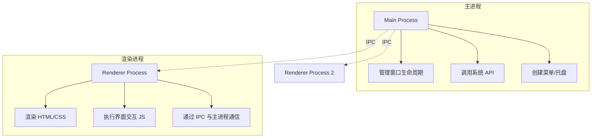
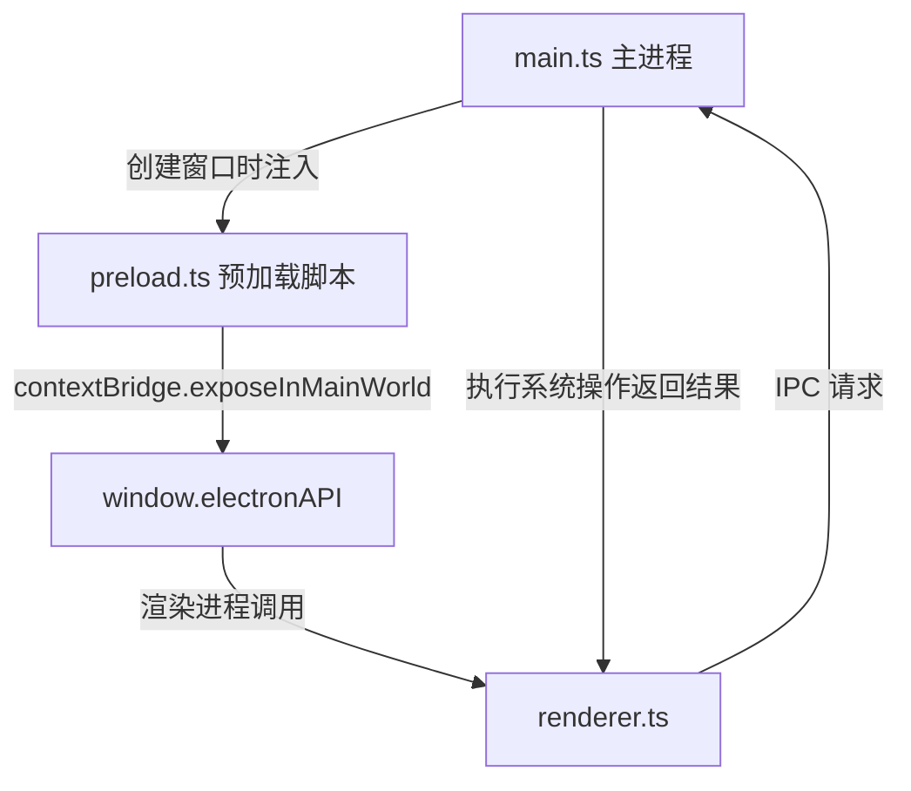
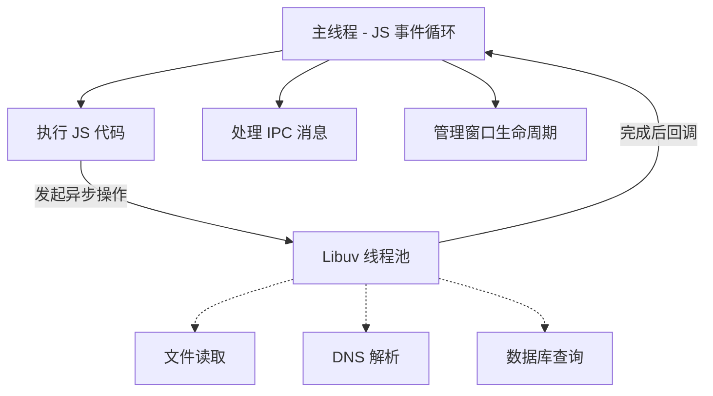

Electron是一个使用JavaScript、HTML、CSS来构建跨平台桌面应用的开源框架。

<!--more-->

## Electron 介绍

### 诞生背景

传统桌面开发面临的核心痛点是：为不同操作系统开发应用需要维护多套代码库（Windows 用 C#/.NET，macOS 用 Swift/Cocoa，Linux 用 GTK+）。Electron 的出现让"一次编写，多端部署"成为可能。

### 核心优势

| 优势                 | 说明                                                            |
| :------------------- | :-------------------------------------------------------------- |
| **技术门槛低** | 使用 HTML/CSS/JavaScript，前端开发者零成本上手                  |
| **原生能力**   | 通过 Node.js 调用操作系统底层 API（文件系统、系统托盘、通知等） |
| **生态丰富**   | npm 百万级包可直接使用                                          |
| **社区成熟**   | VS Code、Slack、Discord、ChatGPT 桌面版等均基于 Electron 构建   |

### 局限性

- **资源占用较高**：打包体积 100MB+，内存占用相对较高
- **性能瓶颈**：不适合图像渲染、大型游戏等高性能场景
- **安全需关注**：需防范 XSS 和 RCE 攻击

---

## 核心架构

### 双进程模型



## 项目结构

### 最小化项目文件

```text
my-electron-app/
├── package.json          # 项目配置
├── main.js              # 主进程入口
└── index.html           # 渲染进程界面
```

### 代码示例

package.json

```json
{
  "name": "my-electron-app",
  "version": "1.0.0",
  "main": "main.js",
  "scripts": {
    "start": "electron ."
  },
  "devDependencies": {
    "electron": "^27.0.0"
  }
}
```

main.js

```javascript
const { app, BrowserWindow } = require('electron');

app.whenReady().then(() => {
    const win = new BrowserWindow({
        width: 800,
        height: 600,
        webPreferences: {
            preload: path.join(__dirname, 'preload.js'),
            contextIsolation: true,
        }
    });
    win.loadFile('index.html');
});
index.html
```

```html
<!DOCTYPE html>
<html>
<head><meta charset="UTF-8"><title>Hello Electron</title></head>
<body>
    <h1>🚀 Hello Electron!</h1>
    <p>这是一个桌面应用</p>
</body>
</html>
```

## 安全架构

### 为什么需要 Preload？

渲染进程默认无法直接访问 Node.js API，这是出于安全考虑——防止恶意网页通过你的应用破坏用户系统。但应用又确实需要调用系统功能，于是 preload 脚本作为"安全桥梁"应运而生。

### "注入"的含义


关键理解："注入"是指在渲染进程的 HTML 开始解析之前，由主进程强制将 preload 脚本放入渲染进程的内存环境并执行。它拥有 require 能力，但通过 contextBridge 有选择地暴露安全 API，而非将整个 Node.js 能力交出。

### 标准安全架构



### 代码实现

preload.ts

```typescript
import { contextBridge, ipcRenderer } from 'electron';

contextBridge.exposeInMainWorld('electronAPI', {
    readFile: (path: string) => ipcRenderer.invoke('file:read', path),
    openExternal: (url: string) => ipcRenderer.invoke('shell:openExternal', url),
});
```

renderer.ts

```typescript
// 只能访问 window 上暴露的 API，无法直接 require 任何模块
const content = await window.electronAPI.readFile('/path/to/file.txt');
```

## 生产级项目架构

### ipcHandler.ts

随着业务增长，main.ts 会充斥大量 IPC 监听逻辑，变得臃肿且难以维护。将 IPC 处理器抽离为独立模块是工程化的必经之路。

### 完整目录结构

```text
src/
├── main/
│   ├── main.ts           # 应用入口：创建窗口、初始化
│   ├── ipcHandlers.ts    # 📌 所有 IPC 处理器集中管理
│   ├── windowManager.ts  # 窗口创建与管理
│   └── menuBuilder.ts    # 菜单构建
├── preload/
│   └── preload.ts        # 安全桥梁
└── renderer/
    ├── App.tsx           # React 根组件
    ├── components/       # UI 组件库
    └── utils/            # 工具函数
```

### 代码实现

ipcHandlers.ts

```typescript
import { ipcMain, shell } from 'electron';
import { readFile } from 'fs/promises';

export function setupIpcHandlers() {
    ipcMain.handle('file:read', async (event, filePath: string) => {
        try {
            const content = await readFile(filePath, 'utf-8');
            return { success: true, content };
        } catch (error) {
            return { success: false, error: error.message };
        }
    });

    ipcMain.handle('shell:openExternal', async (event, url: string) => {
        await shell.openExternal(url);
    });
}
```

main.ts

```typescript
import { app, BrowserWindow } from 'electron';
import { setupIpcHandlers } from './ipcHandlers';

app.whenReady().then(() => {
    setupIpcHandlers(); // 初始化所有 IPC 处理器
    const win = new BrowserWindow({ /* ... */ });
    win.loadFile('index.html');
});
```

## 线程模型

### 多进程架构

```mermaild
graph TD
    A[Electron 应用] --> B[主进程 Main Process]
    A --> C[渲染进程 1 Renderer Process]
    A --> D[渲染进程 2 Renderer Process]
    A --> E[GPU 进程 GPU Process]
  
    B --> B1[Node.js 事件循环]
    C --> C1[Chromium 渲染引擎]
    D --> D1[Chromium 渲染引擎]
    E --> E1[硬件加速合成]
```

### 主进程线程模型

主进程基于 Node.js 事件循环，是单线程模型，但通过 Libuv 线程池（默认 4 个线程）处理异步 I/O：



关键结论：主线程不能阻塞，耗时操作应使用异步 API（如 fs.promises.readFile）。

### 渲染进程线程模型

渲染进程沿用了 Chromium 的多线程架构：

|    线程    |                  职责                  |              影响              |
| :--------: | :------------------------------------: | :-----------------------------: |
|   主线程   | 解析 HTML、执行 JS、样式计算、布局绘制 |     JS 长任务会阻塞界面响应     |
|  合成线程  |          图层合成与 GPU 提交          | 滚动/动画不依赖主线程，保持流畅 |
| 光栅化线程 |            矢量图转像素位图            |       多线程加速图片加载       |
|  工作线程  |          Web Workers 运行环境          |   后台执行计算，不阻塞主线程   |

## .ts vs .tsx

### 核心区别

| 文件类型 |                   用途                   |   JSX支持   |
| :------: | :--------------------------------------: | :---------: |
|   .ts   | 纯逻辑代码（主进程、工具函数、API 服务） |  ❌ 不支持  |
|   .tsx   |          UI 组件（React 组件）          | ✅ 完全支持 |

### 在 Electron 项目中的应用

```text
src/
├── main/          → 全部使用 .ts（主进程无 UI）
├── preload/       → 全部使用 .ts（预加载无 UI）
└── renderer/
    ├── App.tsx    → .tsx（包含 JSX）
    ├── components/ → .tsx（UI 组件）
    └── utils/     → .ts（纯工具函数）
```
